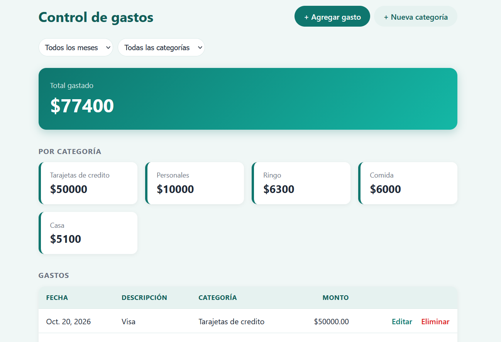

# Control de gastos personales

App web hecha con Django para registrar gastos y ver cuánto se gasta por categoría y por mes.



## Qué hace

- Alta, edición y eliminación de gastos (con pantalla de confirmación antes de borrar).
- Alta de categorías desde la pantalla de inicio.
- Filtros por mes y por categoría; el total y los totales por categoría se recalculan según el filtro.
- Aviso cuando se intenta cargar un gasto repetido (misma descripción, monto y categoría en el mismo mes) o una categoría que ya existe. El gasto repetido se puede cargar igual si se confirma.
- Panel de administración de Django.

## Tecnologías

Python, Django 6.1, SQLite, HTML y CSS.

## Cómo probarlo

Requiere Python 3.12 o superior.

```
python -m venv .venv
.venv\Scripts\Activate.ps1
pip install -r requirements.txt
python manage.py migrate
python manage.py createsuperuser
python manage.py runserver
```

Después abrí http://127.0.0.1:8000/admin/ para crear categorías (o usá el botón "+ Nueva categoría" de la pantalla de inicio) y entrá a http://127.0.0.1:8000/ para cargar y consultar gastos.

## Tests

```
python manage.py test
```

## Ideas para seguir

- Gráfico de gastos por categoría.
- Exportar los gastos a CSV.
- Usuarios, para que cada persona vea solo sus gastos.
